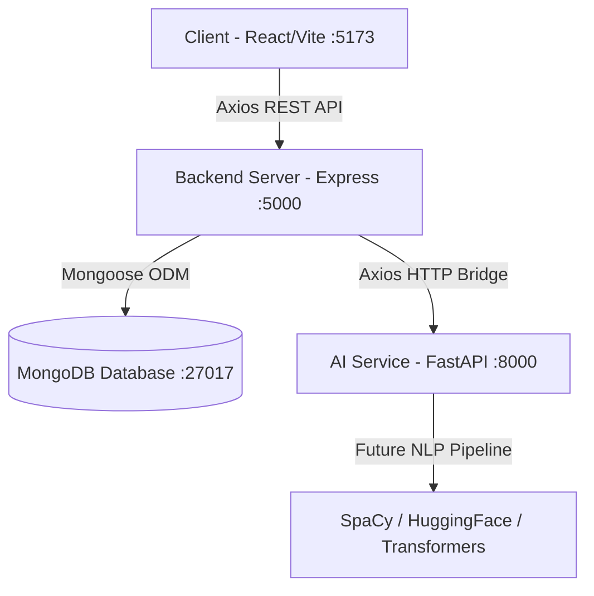

# AI-Based Resume Analyzer & Personalized Career Guidance Platform

An end-to-end intelligent platform engineered to analyze candidate resumes, evaluate ATS compatibility, extract skills and experiences, and deliver tailored career roadmaps and guidance.

---

## 🏛 Architecture

The project is structured into three cleanly decoupled services:

```
├── /client          # Frontend (React 18 + Vite + Tailwind CSS + Recharts + Lucide)
├── /server          # Backend API (Node.js + Express + Mongoose + JWT)
└── /ai-service      # AI & NLP Microservice (Python + FastAPI + Pydantic)
```



---

## ⚡ Quick Start

### 1. Prerequisites
- **Node.js**: v18.0.0+ (Tested on v22.20.0)
- **Python**: v3.10+ (Tested on v3.13.3)
- **MongoDB**: Community Server running on `mongodb://127.0.0.1:27017`

---

### 2. Setup Services

#### A. AI Service (Python FastAPI)
```bash
cd ai-service
# Create and activate virtual environment
python -m venv venv
# On Windows PowerShell:
.\venv\Scripts\Activate.ps1
# On macOS/Linux:
# source venv/bin/activate

# Install dependencies
pip install -r requirements.txt

# Start AI Service (runs on http://127.0.0.1:8000)
uvicorn main:app --reload --port 8000
```

#### B. Backend Server (Node.js / Express)
```bash
cd server
# Install dependencies
npm install

# Copy environment variables
cp .env.example .env

# Run development server (runs on http://localhost:5000)
npm run dev
```

#### C. Frontend Client (React / Vite)
```bash
cd client
# Install dependencies
npm install

# Copy environment variables
cp .env.example .env

# Run development server (runs on http://localhost:5173)
npm run dev
```

---

## 🔍 Foundation Health Check & Inter-Service Endpoints

- **AI Service Health**: `GET http://127.0.0.1:8000/health`
- **Backend Health & MongoDB Status**: `GET http://127.0.0.1:5000/api/v1/health`
- **Backend to AI Service Proxy**: `GET http://127.0.0.1:5000/api/v1/ai/health`
- **Frontend Dashboard**: Open `http://localhost:5173` to view the live connectivity status widget verifying all 3 services and the database.

---

## 📁 Repository Structure

```
d:/project/
├── .env.example
├── .gitignore
├── README.md
├── client/
│   ├── src/
│   │   ├── api/             # Axios API client
│   │   ├── components/
│   │   │   ├── common/      # Buttons, Cards, Badges, Metrics
│   │   │   ├── dashboard/   # Live Health Widget, Recharts Analytics Preview
│   │   │   └── layout/      # Responsive Navbar, Sidebar, Shell
│   │   ├── pages/           # Dashboard, Analyzer, Career Guide, 404
│   │   ├── App.jsx
│   │   └── index.css
│   ├── tailwind.config.js
│   └── vite.config.js
├── server/
│   ├── server.js            # Express server entrypoint
│   ├── src/
│   │   ├── config/          # Environment & MongoDB connection
│   │   ├── controllers/     # Health, AI proxy, Auth controllers
│   │   ├── middleware/      # Centralized error handler & 404
│   │   ├── models/          # User & Resume schemas
│   │   ├── routes/          # Express API router definitions
│   │   └── services/        # AI HTTP service & Auth service
└── ai-service/
    ├── main.py              # FastAPI application entrypoint
    ├── app/
    │   ├── api/             # Endpoints (Health, Analyze)
    │   ├── core/            # App settings & config
    │   ├── schemas/         # Pydantic data contracts
    │   └── services/nlp/    # Pluggable NLP pipeline modules
```
